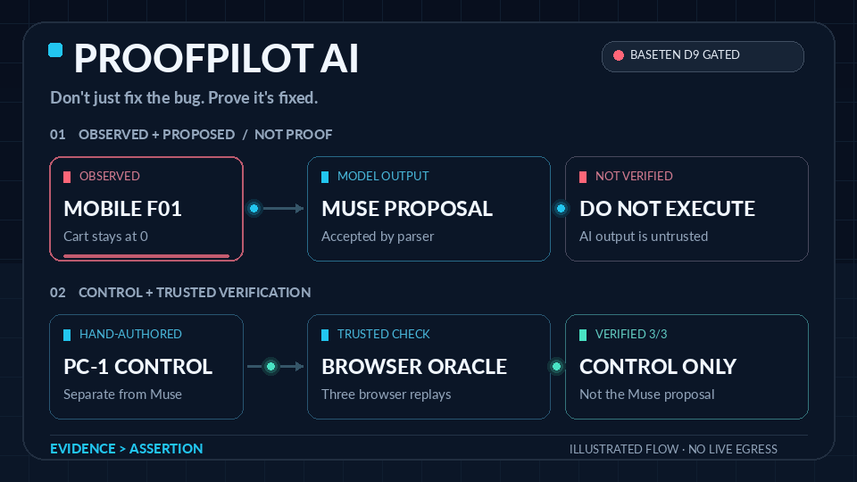
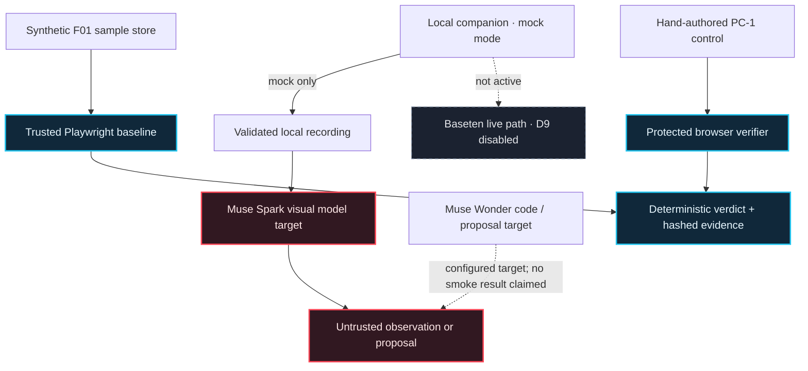

<!-- ProofPilot AI | Evidence-first UI defect verification. -->

<h1 align="center">PROOFPILOT AI</h1>

<p align="center"><strong>Don't just fix the bug. Prove it's fixed.</strong></p>

<p align="center">Reproduce a UI defect. Treat AI output as a hypothesis. Verify changes with a separate, trusted browser oracle.</p>

<p align="center">
  <a href="#the-workflow">See the workflow</a> ·
  <a href="#architecture--trust-boundaries">Explore the architecture</a> ·
  <a href="#evidence-and-current-gates">Inspect the evidence</a> ·
  <a href="#run-the-synthetic-baseline">Run it locally</a>
</p>

<p align="center">
  <a href="https://github.com/mrdzyn/proofpilot-ai/actions/workflows/ci.yml"></a>
  
  
  
  
</p>

<p align="center">
  
</p>

<p align="center"><sub>Illustrated workflow, not a product recording or live inference result. <a href="docs/assets/readme/proofpilot-workflow-poster.png">View the static poster</a> · <a href="docs/README-VISUAL-ASSETS.md">Read the visual asset plan</a></sub></p>

---

## The workflow

**AI output can be plausible without being correct. ProofPilot keeps model claims separate from browser evidence.**

| 01 · Observe | 02 · Propose | 03 · Verify independently |
| :--- | :--- | :--- |
| Reproduce a synthetic UI defect in Chromium at a known viewport and source revision. | Analyze validated media and parse any proposed CSS through a closed grammar. Treat model output as untrusted data. | Run eligible, hand-authored controls through the protected Playwright oracle and inspect attributable evidence. |

**F01:** the mobile Add-to-cart tap is intercepted; the desktop control passes. **The historical Muse Spark proposal is accepted but unverified and has never been run through the verifier.** **PC-1:** a separate, hand-authored control passed three trusted replays. Those results are not interchangeable.

> `PROPOSAL_ACCEPTED` is not `VERIFIED`. Only the independent verifier can establish a candidate result.

## Why this is an engineering system

- **The verifier is separate.** Candidate code cannot rewrite the trusted oracle or decide its own result.
- **The failure is reproducible.** The synthetic F01 fixture demonstrates the mobile interception at 390 × 844 while the 1280 × 800 desktop check passes.
- **Evidence is attributable.** Run identities, source revisions, browser observations and SHA-256 hashes support later inspection.
- **Model output is constrained.** Recording validation, typed response checks and a closed CSS grammar limit what enters the proposal artifact.
- **The operator retains control.** Provider calls, video uploads and candidate execution are separate gated actions. Model text is never a trusted verdict.
- **Refusals stay visible.** Incomplete responses, mismatched models, invalid output, exhausted attempts and corrupted records fail closed.

## Product walkthrough

The repository contains a local dashboard and localhost companion with a **mock-only** analysis path. That lets the offline flow be inspected without claiming that a real Baseten request occurred.

| Synthetic defect | Local mock flow | Independent control |
| :--- | :--- | :--- |
| F01 reproduces: mobile cart stays at 0. | Zone L mock analysis is labeled as mock output. | Hand-authored PC-1 is `VERIFIED` 3/3; the Muse Spark proposal remains `UNTRUSTED PROPOSAL — NOT VERIFIED`. |

The hero above is an animated architectural illustration. It is not a browser capture, provider transcript, or demo recording. See the [visual asset plan](docs/README-VISUAL-ASSETS.md) for capture guidance.

## Architecture & trust boundaries



**Solid paths** show implemented local behavior or recorded evidence. **Dashed paths** show model targets or gated behavior; they do not imply an active provider request or a verified model fix.

### Trust boundary at a glance

| Boundary | What the repository enforces |
| :--- | :--- |
| Fixture → browser | The trusted Playwright oracle observes the tap and cart state at fixed viewports. |
| Recording → model | Media is validated before use; video content and model observations remain untrusted. |
| Model → proposal | Structured output is validated and restricted to a closed CSS grammar. The historical Muse Spark proposal remains unverified. |
| Candidate → verdict | A separate verifier derives results from browser evidence; the hand-authored PC-1 identity is kept separate. |
| Local companion → provider | The companion's runnable path is mock-only. Baseten live inference remains disabled while D9 is pending. |

## Evidence and current gates

The state below reflects repository evidence and the current project status. It is not a blanket claim that every feature is production-ready.

| Evidence | Status | What it means |
| :--- | :--- | :--- |
| F01 mobile baseline | `REPRODUCED` | The expected mobile failure is observed; desktop control passes. |
| Hand-authored PC-1 | `VERIFIED` 3/3 | Three clean trusted replays for the hand-authored control only. |
| Historical Muse Spark proposal | `PROPOSAL_ACCEPTED` | One proposal artifact exists; it is untrusted, unexecuted and not verified. |
| Meta model discovery | **PASS** for the exact configured IDs | Discovery confirms availability; it does not establish inference behavior. |
| Per-model minimal smoke tests | **NOT TESTED** | No smoke-test pass is claimed for the selected model roles here. Historical Spark runs are documented separately in [project status](docs/STATUS.md). |
| Baseten live inference | **Disabled** | D9 is pending. No Baseten live inference has run. |
| Public hosted sandbox / arbitrary-site auto-fix | **Not available** | These are outside the implemented local synthetic workflow. |

`VERIFIED` applies only to the **hand-authored PC-1 control**. Its CSS happens to match the historical Muse Spark proposal; that equality does not transfer evidence or provenance to the proposal.

### Model roles

The checked-in defaults in [`.env.example`](.env.example) use these exact Meta model IDs:

- **Visual / multimodal:** `muse-spark-1.3`
- **Code reasoning / patch-proposal target:** `muse-wonder-1.0`

Contributor variants are not the default targets. The historical Muse Spark proposal remains the one recorded in project evidence; the Muse Wonder target is not represented as a completed inference. Model discovery and inference are separate checks.

See [project status](docs/STATUS.md), the [historical Meta execution report](docs/LIVE-C3-01-EXECUTION-REPORT.md), and [hackathon contribution provenance](HACKATHON_CONTRIBUTIONS.md) for the detailed record.

## Run the synthetic baseline

**Requirements:** Node.js 24+, pnpm 12, and Chromium via Playwright. These steps use the local synthetic fixture and do not call an AI provider or require `.env.local`.

```bash
corepack enable
pnpm install --frozen-lockfile
pnpm exec playwright install chromium

pnpm lint
pnpm typecheck
pnpm test:unit
pnpm test:security

# The expected mobile failure is reported as a successful baseline reproduction.
pnpm f01:baseline

# Optional: serve the synthetic product fixture locally.
pnpm fixture:serve
```

Open `http://127.0.0.1:4173/product/demo` after starting the fixture server. The raw `pnpm test:e2e:f01` command is expected to exit non-zero on the intentionally defective mobile fixture; use `pnpm f01:baseline` for the green reproduction assertion.

## Repository map

```text
fixtures/sample-store/       Synthetic F01 store; only the intended source is patchable
verifier/                    Protected Playwright oracle
packages/core/               Deterministic classification, policy and evidence logic
packages/inference/          Meta and Baseten adapters; video and proposal paths
packages/intake/             Recording validation, conversion and consent
packages/live-analysis/      Local companion and mock-only analysis flow
dashboard/                   Local React dashboard, including Zone L
packages/provenance/         Proposal artifact and source provenance checks
scripts/                     Baseline, recording and operator commands
tests/                       Unit, security, HTTP and browser integration coverage
docs/                        Architecture, status, security and evidence
```

## Built for the hackathon

ProofPilot AI was built for the **Meta Global AI Developer Hackathon — Push the Frontier (2026)**. The repository distinguishes pre-existing delivery scaffolding from hackathon work in [Hackathon Contributions & Provenance](HACKATHON_CONTRIBUTIONS.md).

**Stack:** TypeScript · Node.js · React + Vite · Playwright / Chromium · FFmpeg · GitHub Actions · Meta Model API · Baseten transport (disabled).

## Contributing and provenance

Contributors follow the repository's [operating model](AGENTS.md). See the [testing policy](docs/TESTING.md), [security baseline](docs/SECURITY.md), and [hackathon contribution provenance](HACKATHON_CONTRIBUTIONS.md). No agent may push, merge, deploy, or submit without explicit owner authorization.

MIT licensed — see [LICENSE](LICENSE).
