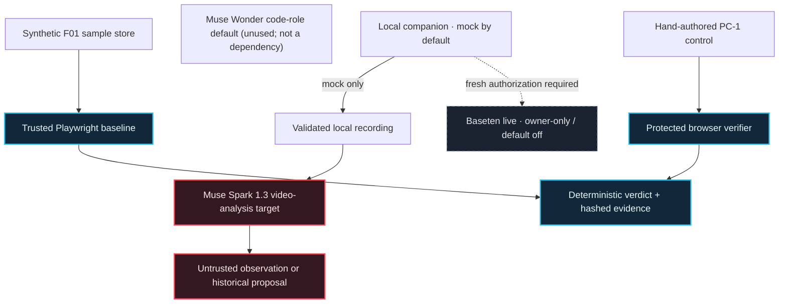

<!-- ProofPilot AI | Evidence-first UI defect verification. -->

<h1 align="center">PROOFPILOT AI</h1>

<p align="center"><strong>Don't just fix the bug. Prove it's fixed.</strong></p>

<p align="center">Reproduce a UI defect. Treat AI output as a hypothesis. Verify changes with a separate, trusted browser oracle.</p>

<p align="center">
  <a href="#the-workflow">See the workflow</a> ·
  <a href="#architecture--trust-boundaries">Explore the architecture</a> ·
  <a href="#evidence-and-current-gates">Inspect the evidence</a> ·
  <a href="#run-the-synthetic-baseline">Run it locally</a>
</p>

<p align="center">
  <a href="https://github.com/mrdzyn/proofpilot-ai/actions/workflows/ci.yml"></a>
  
  
  
  
</p>

<p align="center">
  
</p>

<p align="center"><sub>Illustrated workflow, not a product recording or live inference result. <a href="docs/assets/readme/proofpilot-workflow-poster.png">View the static poster</a> · <a href="docs/README-VISUAL-ASSETS.md">Read the visual asset plan</a></sub></p>

---

## The workflow

**AI output can be plausible without being correct. ProofPilot keeps model claims separate from browser evidence.**

### 01 · Observe

Reproduce a synthetic UI defect in Chromium at a known viewport and source revision.

### 02 · Propose

Analyze validated media and parse any proposed CSS through a closed grammar. Treat model output as untrusted data.

### 03 · Verify independently

Run eligible, hand-authored controls through the protected Playwright oracle and inspect attributable evidence.

**F01:** the mobile Add-to-cart tap is intercepted; the desktop control passes. **The historical Muse Spark proposal is accepted but unverified and has never been run through the verifier.** **PC-1:** a separate, hand-authored control passed three trusted replays. Those results are not interchangeable.

> `PROPOSAL_ACCEPTED` is not `VERIFIED`. Only the independent verifier can establish a candidate result.

## Why this is an engineering system

- **The verifier is separate.** Candidate code cannot rewrite the trusted oracle or decide its own result.
- **The failure is reproducible.** The synthetic F01 fixture demonstrates the mobile interception at 390 × 844 while the 1280 × 800 desktop check passes.
- **Evidence is attributable.** Run identities, source revisions, browser observations and SHA-256 hashes support later inspection.
- **Model output is constrained.** Recording validation, typed response checks and a closed CSS grammar limit what enters the proposal artifact.
- **The operator retains control.** Provider calls, video uploads and candidate execution are separate gated actions. Model text is never a trusted verdict.
- **Refusals stay visible.** Incomplete responses, mismatched models, invalid output, exhausted attempts and corrupted records fail closed.

## Product walkthrough

The repository contains a local dashboard and localhost companion. **Mock mode is the default** and needs no provider credentials. A separately gated **owner-started Baseten live mode** exists but is not enabled during ordinary use. The first authorized Baseten attempt returned HTTP 403 and is permanently spent; **there is no successful Baseten analysis result to present yet**.

- **Synthetic defect:** F01 reproduces; the mobile cart stays at 0.
- **Local mock flow:** Zone L can demonstrate upload, analysis and provenance with fixture output; no provider inference occurs in mock mode.
- **Independent control:** hand-authored PC-1 is `VERIFIED` 3/3; the Muse Spark proposal remains `UNTRUSTED PROPOSAL — NOT VERIFIED`.

The hero above is an animated architectural illustration. It is not a browser capture, provider transcript, or demo recording. See the [visual asset plan](docs/README-VISUAL-ASSETS.md) for capture guidance.

## Architecture & trust boundaries



**Solid paths** show implemented local behavior or recorded evidence. **Dashed paths** show model targets or gated behavior; they do not imply an active provider request or a verified model fix.

### Trust boundary at a glance

- **Fixture → browser:** the trusted Playwright oracle observes the tap and cart state at fixed viewports.
- **Recording → model:** media is validated before use; video content and model observations remain untrusted.
- **Model → proposal:** structured output is validated and restricted to a closed CSS grammar. The historical Muse Spark proposal remains unverified.
- **Candidate → verdict:** a separate verifier derives results from browser evidence; the hand-authored PC-1 identity is kept separate.
- **Local companion → provider:** mock mode is always the default. Live inference requires an explicit owner-started `--live`, a private key, the exact hackathon model and certified F01 video pin, and **a fresh, separately approved attempt** tracked in a durable spend ledger. The first attempt is exhausted; there are no automatic retries.

## Evidence and current gates

The state below reflects repository evidence and the current project status. It is not a blanket claim that every feature is production-ready.

- **F01 mobile baseline — `REPRODUCED`:** the expected mobile failure is observed; desktop control passes.
- **Hand-authored PC-1 — `VERIFIED` 3/3:** three clean trusted replays for the hand-authored control only.
- **Historical Muse Spark proposal — `PROPOSAL_ACCEPTED`:** one proposal artifact exists; it is untrusted, unexecuted and not verified.
- **Historical Muse Spark 1.3 video smoke — COMPLETED ONCE (operator-reported):** the second of two authorized Meta video-analysis attempts returned a schema-valid, untrusted symptom. This is neither a model-verified fix nor a current-access guarantee. **Muse Wonder smoke — NOT TESTED.** See [live smoke evidence](docs/LIVE-SMOKE.md).
- **Baseten D9-LIVE-01 — `REFUSED / SPENT` (owner-reported, November 2, 2026):** one authorized analysis POST against the **incorrect unsuffixed public model** returned `TRANSPORT_HTTP` HTTP 403. The hash-chained ledger records one permanently spent send-boundary attempt; no model observations or token usage were returned, and billing is unverified. No retry occurred. See [D9 runbook §7](docs/UI-C3-02-D9-RUNBOOK.md#7-d9-live-01-outcome-owner-reported-recorded-agent-did-not-run-it).
- **Baseten hackathon model correction — MERGED (PR #37):** the organizer-issued key requires exactly `meta-models/muse-spark-open-1026`, not the public `meta-models/muse-spark-open`. The corrected pin, refusal gates and fake-provider tests are merged.
- **Corrected Baseten catalog preflight — PASS (owner-reported, November 2, 2026):** authenticated, non-inference `GET /v1/models` listed the approved `-1026` ID (21 models in catalog). This establishes catalog reachability, **not** successful inference, billing, or video compatibility on the hackathon deployment. A new live request is **not** authorized by this README.
- **Public hosted sandbox / arbitrary-site auto-fix — unavailable:** outside the implemented local synthetic workflow.

`VERIFIED` applies only to the **hand-authored PC-1 control**. Its CSS happens to match the historical Muse Spark proposal; that equality does not transfer evidence or provenance to the proposal.

### Model roles

The checked-in defaults in [`.env.example`](.env.example) name these Meta model IDs:

- **Visual / multimodal:** `muse-spark-1.3`
- **Code-role configuration default (unused; not a runtime dependency):** `muse-wonder-1.0`

Contributor variants are not configured as defaults. Candidate proposals currently use Muse Spark. Muse Wonder is an unused configuration default, not an implemented dependency or patcher. Its smoke test remains untested.

The **separate Baseten live-analysis transport** uses the hackathon-only `meta-models/muse-spark-open-1026` model pin (PR #37); it is **not** the Meta visual `muse-spark-1.3` variable in `.env.example`, nor the generic public Baseten model slug. Credential values stay in the owner's untracked environment.

See [project status](docs/STATUS.md), the [historical Meta execution report](docs/LIVE-C3-01-EXECUTION-REPORT.md), and [hackathon contribution provenance](HACKATHON_CONTRIBUTIONS.md) for the detailed record.

## Demonstrate the local app safely

**Default mock demonstration (no provider call, no key required):**

```bash
pnpm --dir dashboard build
node scripts/c3-live-analysis.ts --port 5188 --serve "$PWD/dashboard/dist"
```

Open `http://127.0.0.1:5188`, type `pair` in the companion Terminal to obtain a single-use pairing code, and use Zone L with a synthetic F01 recording. The selected file must be explicitly permitted in the Terminal before local upload; then run the mock fixture analysis. Zone L contains static **MOCK** copy and an **Analyze with mock fixture** button even in owner-started live mode; **neither label proves provider provenance**. Check the companion banner and completed result's `baseten-live` provenance when presenting any real inference.

**Real Baseten demonstration:** needs a **new**, explicit owner authorization, a distinct immutable spend record and owner-only credential handling. The original D9-LIVE-01 record is spent and must never be reset, replaced or reused to rearm. The correct `-1026` model passed a catalog preflight, but this deployment's support for the exact inline `video_url` MP4 payload is unconfirmed. Consult the [owner D9 runbook](docs/UI-C3-02-D9-RUNBOOK.md). This README does not itself authorize another provider request.

## Run the synthetic baseline

**Requirements:** Node.js 24+, pnpm 12, and Chromium via Playwright. These steps use the local synthetic fixture and do not call an AI provider or require `.env.local`.

```bash
corepack enable
pnpm install --frozen-lockfile
pnpm exec playwright install chromium

pnpm lint
pnpm typecheck
pnpm test:unit
pnpm test:security

# The expected mobile failure is reported as a successful baseline reproduction.
pnpm f01:baseline

# Optional: serve the synthetic product fixture locally.
pnpm fixture:serve
```

Open `http://127.0.0.1:4173/product/demo` after starting the fixture server. The raw `pnpm test:e2e:f01` command is expected to exit non-zero on the intentionally defective mobile fixture; use `pnpm f01:baseline` for the green reproduction assertion.

## Repository map

```text
fixtures/sample-store/       Synthetic F01 store; only the intended source is patchable
verifier/                    Protected Playwright oracle
packages/core/               Deterministic classification, policy and evidence logic
packages/inference/          Meta and Baseten adapters; video and proposal paths
packages/intake/             Recording validation, conversion and consent
packages/live-analysis/      Local companion, default-off Baseten transport and mock adapter
dashboard/                   Local React dashboard, including Zone L
packages/provenance/         Proposal artifact and source provenance checks
scripts/                     Baseline, recording and operator commands
tests/                       Unit, security, HTTP and browser integration coverage
docs/                        Architecture, status, security and evidence
```

## Built for the hackathon

ProofPilot AI was built for the **Meta Global AI Developer Hackathon — Push the Frontier (2026)**. The repository distinguishes pre-existing delivery scaffolding from hackathon work in [Hackathon Contributions & Provenance](HACKATHON_CONTRIBUTIONS.md).

**Stack:** TypeScript · Node.js · React + Vite · Playwright / Chromium · FFmpeg · GitHub Actions · Meta Model API · Baseten owner-only transport (default off).

## Contributing and provenance

Contributors follow the repository's [operating model](AGENTS.md). See the [testing policy](docs/TESTING.md), [security baseline](docs/SECURITY.md), and [hackathon contribution provenance](HACKATHON_CONTRIBUTIONS.md). No agent may push, merge, deploy, or submit without explicit owner authorization.

MIT licensed — see [LICENSE](LICENSE).
