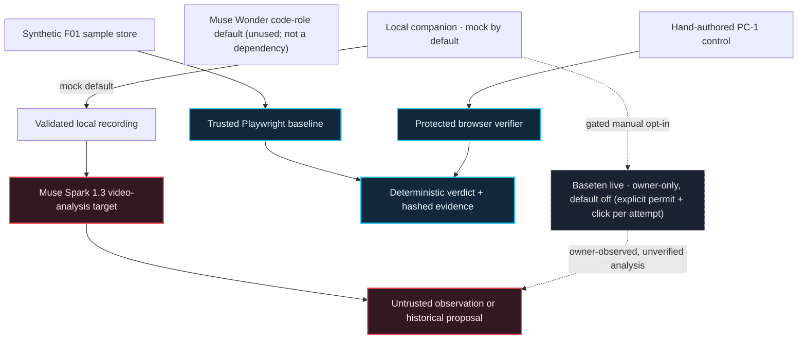

<!-- ProofPilot AI | Evidence-first UI defect verification. -->

<h1 align="center">PROOFPILOT AI</h1>

<p align="center"><strong>Don't just fix the bug. Prove it's fixed.</strong></p>

<p align="center">Reproduce a UI defect. Treat AI output as a hypothesis. Verify changes with a separate, trusted browser oracle.</p>

<p align="center">
  <a href="#demo-in-90-seconds">Demo in 90 seconds</a> ·
  <a href="#the-workflow">See the workflow</a> ·
  <a href="#architecture--trust-boundaries">Explore the architecture</a> ·
  <a href="#evidence-and-current-gates">Inspect the evidence</a> ·
  <a href="#run-the-synthetic-baseline">Run it locally</a>
</p>

<p align="center">
  <a href="https://github.com/mrdzyn/proofpilot-ai/actions/workflows/ci.yml"></a>
  
  
  
  
</p>

<p align="center">
  
</p>

<p align="center"><sub>Illustrated workflow, not a product recording or live inference result. <a href="docs/assets/readme/proofpilot-workflow-poster.png">View the static poster</a> · <a href="docs/README-VISUAL-ASSETS.md">Read the visual asset plan</a></sub></p>

---

## Demo in 90 seconds

**A synthetic mobile bug, a real AI observation, and an independent browser verdict.** The owner has already completed an authorized live Baseten F01 analysis. The walkthrough below **reuses that captured result**; recording a demonstration does not authorize another paid request.

| Segment | Show on screen | Explain |
| --- | --- | --- |
| **0–15s — The defect** | F01 Sample Store at **390 × 844**, with **Add to cart** tapped and the header still showing **Cart 0**. | The mobile tap does not update the cart; the desktop control is separate. |
| **15–35s — Reproducible evidence** | Dashboard recording/baseline zones or the certified Playwright evidence. | A trusted browser oracle reproduces the mobile failure rather than relying on a model guess. |
| **35–60s — Real Baseten analysis** | The **already completed** Zone L result: provider/model, **LIVE VIA BASETEN — UNVERIFIED**, and reported usage. | Muse Spark Open described two visible taps and an unchanged cart. It did **not** prove why the tap failed. |
| **60–80s — Independent verification** | The hand-authored **PC-1 VERIFIED 3/3** control and its browser evidence. | This result belongs only to the hand-authored control; it does **not** verify or execute the historical AI proposal. |
| **80–90s — The difference** | ProofPilot's verdict/provenance labels. | **Model output is a hypothesis. Reproducible browser evidence is the proof.** |

The hero animation above is **illustrative**, not a real product recording. There is **no public hosted demo URL and no video linked here yet**; the owner will capture genuine local footage. Never show pairing codes, credentials, private local paths, or notifications. If the live result is no longer displayed, **do not spend another provider attempt to recreate a screenshot**.

### Actual Baseten F01 analysis — owner-observed

On **November 2, 2026**, after audited [PR #41](https://github.com/mrdzyn/proofpilot-ai/pull/41) increased the analysis output cap from **1,024 to 2,048 tokens**, the owner ran one manually permitted analysis of the certified synthetic F01 MP4 via the localhost companion.

- **Model:** meta-models/muse-spark-open-1026 (hackathon-issued Baseten model).
- **Run displayed locally:** local-2026-11-02-001.
- **Provider-reported usage:** **1,631 prompt + 1,309 completion = 2,940 total tokens** (not a billing statement).
- **Observed output:** the recording depicts an Enamel Trail Mug product page, two visible Add to cart tap indicators, and **Cart 0** remaining unchanged; the model explicitly stated that tap registration, network/backend state, and off-screen feedback were unknown.
- **Classification:** **accepted live analysis, UNVERIFIED model observations** — **not** a root-cause diagnosis, a verified fix, or a provider billing audit.

The owner supplied a screenshot and displayed observation text. The first authorized analysis in this three-attempt session previously refused as **TRANSPORT_TRUNCATED** at 1,024 tokens. The subsequent 2,048-token request completed. This supports the bounded remediation but does not prove reasoning-token exhaustion caused the original refusal. **The post-success ledger count still awaits an owner readback**; the runtime records each send before POST and never refunds a spend. This README authorizes no further live inference.

## The workflow

**AI output can be plausible without being correct. ProofPilot keeps model claims separate from browser evidence.**

### 01 · Observe

Reproduce a synthetic UI defect in Chromium at a known viewport and source revision.

### 02 · Propose

Analyze validated media and parse any proposed CSS through a closed grammar. Treat model output as untrusted data.

### 03 · Verify independently

Run eligible, hand-authored controls through the protected Playwright oracle and inspect attributable evidence.

**F01:** the mobile Add-to-cart tap is intercepted; the desktop control passes. **The historical Muse Spark proposal is accepted but unverified and has never been run through the verifier.** **PC-1:** a separate, hand-authored control passed three trusted replays. Those results are not interchangeable.

> `PROPOSAL_ACCEPTED` is not `VERIFIED`. Only the independent verifier can establish a candidate result.

## Why this is an engineering system

- **The verifier is separate.** Candidate code cannot rewrite the trusted oracle or decide its own result.
- **The failure is reproducible.** The synthetic F01 fixture demonstrates the mobile interception at 390 × 844 while the 1280 × 800 desktop check passes.
- **Evidence is attributable.** Run identities, source revisions, browser observations and SHA-256 hashes support later inspection.
- **Model output is constrained.** Recording validation, typed response checks and a closed CSS grammar limit what enters the proposal artifact.
- **The operator retains control.** Provider calls, video uploads and candidate execution are separate gated actions. Model text is never a trusted verdict.
- **Refusals stay visible.** Incomplete responses, mismatched models, invalid output, exhausted attempts and corrupted records fail closed.

## Product walkthrough

The repository includes a local React dashboard and localhost companion. It defaults to **mock analysis**, so anyone can inspect the flow and its safeguards without a Baseten key or a billable request.

- **Reproduction:** a trusted Playwright mobile tap reproduces F01 with a cart count of 0; the desktop baseline is a separate passing control.
- **Analysis:** Zone L distinguishes mock output from the **owner-observed successful live Baseten analysis** documented above. Provider output is explicitly **UNVERIFIED**.
- **Verification:** hand-authored PC-1 passed **three independent Playwright replays**. The historical model-generated proposal remains **unexecuted and unverified**.
- **Safety:** live mode is owner-armed, limited to the certified synthetic recording, zero proposals, one fresh terminal permit plus one click per send, durable no-refund ledger, and no automatic retries.

For a demo **without another paid call**, capture the owner's already completed Zone L screen and continue with the read-only evidence and verification panels. The [D9 runbook](docs/UI-C3-02-D9-RUNBOOK.md) is for strictly controlled owner operations, **not** a public live-inference quick-start.

The README's animated illustration is not a browser capture, provider transcript, or actual product recording. See the [visual asset plan](docs/README-VISUAL-ASSETS.md) for genuine capture guidance.

## Architecture & trust boundaries



**Solid paths** show implemented local behavior or recorded evidence. **Dashed paths** show model targets or gated/owner-observed behavior; they do not imply an active provider request, an authorized repeat inference, or a verified model fix.

### Trust boundary at a glance

- **Fixture → browser:** the trusted Playwright oracle observes the tap and cart state at fixed viewports.
- **Recording → model:** media is validated before use; video content and model observations remain untrusted.
- **Model → proposal:** structured output is validated and restricted to a closed CSS grammar. The historical Muse Spark proposal remains unverified.
- **Candidate → verdict:** a separate verifier derives results from browser evidence; the hand-authored PC-1 identity is kept separate.
- **Local companion → provider:** the default path is mock-only. Owner-supervised live inference against the hackathon model is available only with an explicit per-attempt opt-in (durable spend ledger, zero proposals, no retries); historical one-shot attempts are spent and the ledgers are frozen.

## Evidence and current gates

The state below reflects repository evidence and the current project status. It is not a blanket claim that every feature is production-ready.

- **F01 mobile baseline — `REPRODUCED`:** the expected mobile failure is observed; desktop control passes.
- **Hand-authored PC-1 — `VERIFIED` 3/3:** three clean trusted replays for the hand-authored control only.
- **Historical Muse Spark proposal — `PROPOSAL_ACCEPTED`:** one proposal artifact exists; it is untrusted, unexecuted and not verified.
- **Historical Meta Muse Spark 1.3 video smoke — completed once (operator-reported):** the second of two authorized Meta video analyses produced a schema-valid, untrusted symptom. This neither verifies a fix nor guarantees ongoing account access. **Muse Wonder smoke — NOT TESTED.** See [live smoke evidence](docs/LIVE-SMOKE.md).
- **Baseten live analysis — one accepted owner-operated result (UNVERIFIED):** after two historical refused/spent one-shot attempts (D9-LIVE-01 HTTP 403, D9-LIVE-02 HTTP 2xx TRANSPORT_SHAPE), the D9-LIVE-V2-QA-01 session produced a TRUNCATED refusal at 1,024 tokens and then an **accepted** F01 analysis at 2,048. Owner screenshot and usage are described above; the **post-success ledger count awaits owner readback**. The hackathon model pin, manual permit/click, synthetic F01 pin, zero proposals, and no-retry/no-refund rules remain. Billing unverified. See the [runbook](docs/UI-C3-02-D9-RUNBOOK.md).
- **Public hosted sandbox / arbitrary-site auto-fix — unavailable:** outside the implemented local synthetic workflow.

`VERIFIED` applies only to the **hand-authored PC-1 control**. Its CSS happens to match the historical Muse Spark proposal; that equality does not transfer evidence or provenance to the proposal.

### Model roles

The checked-in defaults in [`.env.example`](.env.example) name these Meta model IDs:

- **Visual / multimodal:** `muse-spark-1.3`
- **Code-role configuration default (unused; not a runtime dependency):** `muse-wonder-1.0`

Contributor variants are not configured as defaults. Candidate proposals currently use Muse Spark. Muse Wonder is an unused configuration default, not an implemented dependency or patcher. Its smoke test remains untested.

See [project status](docs/STATUS.md), the [historical Meta execution report](docs/LIVE-C3-01-EXECUTION-REPORT.md), and [hackathon contribution provenance](HACKATHON_CONTRIBUTIONS.md) for the detailed record.

## Run the synthetic baseline

**Requirements:** Node.js 24+, pnpm 12, and Chromium via Playwright. These steps use the local synthetic fixture and do not call an AI provider or require `.env.local`.

```bash
corepack enable
pnpm install --frozen-lockfile
pnpm exec playwright install chromium

pnpm lint
pnpm typecheck
pnpm test:unit
pnpm test:security

# The expected mobile failure is reported as a successful baseline reproduction.
pnpm f01:baseline

# Optional: serve the synthetic product fixture locally.
pnpm fixture:serve
```

Open `http://127.0.0.1:4173/product/demo` after starting the fixture server. The raw `pnpm test:e2e:f01` command is expected to exit non-zero on the intentionally defective mobile fixture; use `pnpm f01:baseline` for the green reproduction assertion.

## Show the dashboard locally (no AI provider calls)

For a **non-billable** local demonstration from a fresh checkout, install the dependencies using the baseline instructions above, then:

~~~bash
pnpm --dir dashboard build
node scripts/c3-live-analysis.ts --port 5188 --serve "$PWD/dashboard/dist"
~~~

Open **http://127.0.0.1:5188** and use the companion terminal's **pair** command to connect Zone L. Without the explicit **--live** flag, the companion starts in **mock-only** mode; it does not read Baseten credentials or send inference requests. To exercise mock analysis, choose an owner-generated synthetic MP4 and follow the UI's mock permit/upload flow. The certified F01 MP4 recording is **not checked into Git**.

**For the owner's live-result demo:** keep the existing successful Zone L screen visible, and capture that result as-is. Do not start a second companion, click Analyze again, or spend another attempt to replace a vanished result. A real recording or screenshot can be shown in a narrated video after secret/privacy review. No key, private video, live spend ledger, or raw provider response belongs in this public repository.

## Repository map

```text
fixtures/sample-store/       Synthetic F01 store; only the intended source is patchable
verifier/                    Protected Playwright oracle
packages/core/               Deterministic classification, policy and evidence logic
packages/inference/          Meta and Baseten adapters; video and proposal paths
packages/intake/             Recording validation, conversion and consent
packages/live-analysis/      Local companion and mock-by-default analysis flow (owner-supervised live path for the hackathon model)
dashboard/                   Local React dashboard, including Zone L
packages/provenance/         Proposal artifact and source provenance checks
scripts/                     Baseline, recording and operator commands
tests/                       Unit, security, HTTP and browser integration coverage
docs/                        Architecture, status, security and evidence
```

## Built for the hackathon

ProofPilot AI was built for the **Meta Global AI Developer Hackathon — Push the Frontier (2026)**. The repository distinguishes pre-existing delivery scaffolding from hackathon work in [Hackathon Contributions & Provenance](HACKATHON_CONTRIBUTIONS.md).

**Stack:** TypeScript · Node.js · React + Vite · Playwright / Chromium · FFmpeg · GitHub Actions · Meta Model API · Baseten transport (owner-supervised only).

## Contributing and provenance

Contributors follow the repository's [operating model](AGENTS.md). See the [testing policy](docs/TESTING.md), [security baseline](docs/SECURITY.md), and [hackathon contribution provenance](HACKATHON_CONTRIBUTIONS.md). No agent may push, merge, deploy, or submit without explicit owner authorization.

MIT licensed — see [LICENSE](LICENSE).
