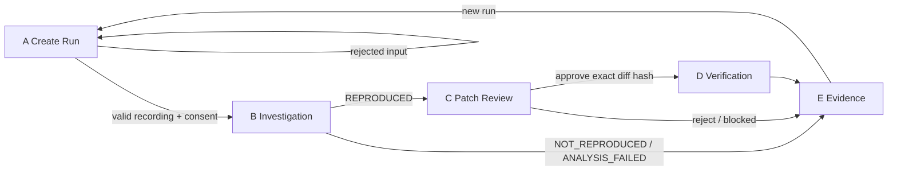

# ProofPilot AI — Product Screen Map and Mockup Proposal

- **Status:** PROPOSAL. **NOT APPROVED.** No product UI shell exists and none may be built until the project owner approves this direction (`docs/DESIGN-SYSTEM.md` design-first gate).
- **Task:** `tasks/PP-META-I1-C2A.md` (design brief only; UI shell is a later, separately authorised task)
- **Product contract:** `docs/PRODUCT.md` (screens A–E, verdict definition). Run states: `packages/core/src/status.ts`. Intake/consent/symptom contracts: `packages/intake/`, `packages/core/src/symptom.ts`.
- **Platform profile:** web (`design/platforms/web.md`), WCAG 2.2 AA baseline (`docs/ACCESSIBILITY.md`). Tokens: `design/tokens/design-tokens.json` (semantic roles only; no hard-coded colours).

## 1. Design principles specific to ProofPilot

1. **Never overstate.** The UI may show `VERIFIED` only when the deterministic verdict engine says so. Model output is always labelled **Hypothesis**; browser-run results **Observed**; a missing link in the evidence chain is **Not reproduced** or **Inconclusive**, never a softened success.
2. **Say what is real.** Every result carries an evidence-kind label: **Live** (real Meta call), **Mock** (test transport), or **Replay** (stored real run). Mock data can never be styled like live data.
3. **Consent is a gate, not a banner.** Nothing is uploaded to Meta until the user opts in for *this run and this exact video*.
4. **Meaning never relies on colour alone.** Every status has an icon and a text label.
5. **Synthetic data only.** Fixtures, recordings and screenshots in the product are the owned sample-store; the UI says so.

## 2. Screen inventory

| ID | Screen | Purpose | RunStatus values shown |
|---|---|---|---|
| A | Create Run | Choose fixture, add recording + note, give consent, start | `CREATED` |
| B | Investigation | Show the model's hypothesis and the real browser reproduction | `VIDEO_ANALYZED`, `REPRO_RUNNING`, `REPRODUCED`, `NOT_REPRODUCED`, `ANALYSIS_FAILED` |
| C | Patch Review | Read-only diff, scope check, explicit local approval | `PATCH_PROPOSED`, `AWAITING_PATCH_APPROVAL`, `PATCH_REJECTED`, `SECURITY_BLOCKED` |
| D | Verification | Independent Before (red) / After (green) columns and verdict | `PATCH_APPLIED`, `VERIFY_RUNNING`, `VERIFIED`, `PATCH_FAILED`, `INCONCLUSIVE` |
| E | Evidence | Hashes, model IDs, limitations, export | all terminal states |
| — | Run header (shared) | Run ID, fixture, status chip, evidence-kind label, step progress | all |

C2A defines A and the Meta-facing part of B. C and D–E depend on later increments (patch proposal, verifier, evidence export) and are specified here only so navigation and states stay coherent.

## 3. Screen map and flow



Primary flow (happy path): A → B → C → D → E. Every non-success branch ends in **E** with its honest status, so the user always gets a record of what was and was not shown.

## 4. Wireframes (low fidelity)

> All values in these wireframes (hashes, SHAs, token counts, timings, diff content) are **illustrative placeholders**, not results from any run.

### A — Create Run

Desktop (≥ 1024 px): two columns, form left, "what will happen" right. Mobile (≤ 640 px): single column, the right column becomes a collapsible section above the primary button.

```text
┌──────────────────────────────────────────────────────────────────────┐
│ ProofPilot AI                                        [Run: new]      │
├──────────────────────────────────────────────────────────────────────┤
│ Create run                                                           │
│                                                                      │
│ 1 Fixture            ( ) F01 Sample store, cart bug  (synthetic)     │
│                      ( ) F02 Subtotal (not available yet)            │
│                                                                      │
│ 2 Recording          [ Choose MP4… ]  MP4 · ≤ 30 s · ≤ 25 MB         │
│                      ✔ clip.mp4  10.0 s · 390×844 · 43 KB            │
│                        SHA-256 3f9a…c1  [Replace]                    │
│                                                                      │
│ 3 What went wrong    [ Cart stays at 0 when I tap Add to cart…    ]  │
│   (optional, ≤ 1000 characters; treated as data, not instructions)  │
│                                                                      │
│ 4 Send to Meta?      [ ] I agree this recording is sent to Meta to   │
│                          be analysed by Muse Spark for THIS run.     │
│                      [ ] It is my own or synthetic, with no customer │
│                          or payment data.                            │
│                                                                      │
│                                  [ Start analysis ]  (disabled until │
│                                                       1–4 complete)  │
└──────────────────────────────────────────────────────────────────────┘
```

### B — Investigation

```text
┌──────────────────────────────────────────────────────────────────────┐
│ Run F01-…  [● Reproduced]  [Live]            Step 2 of 5 ▸▸▹▹▹       │
├───────────────────────────────┬──────────────────────────────────────┤
│ MODEL HYPOTHESIS  (Muse Spark)│ OBSERVED IN BROWSER (Playwright)     │
│ ⚠ Not evidence                │ ✔ Run at 390×844, baseline SHA 7066… │
│ Summary: Tapping Add to cart… │ Tap at (195, 494) received by        │
│ Expected: cart count 1        │   promo-overlay                      │
│ Actual:   cart count stays 0  │ cart-count: expected 1, received 0   │
│ Observations                  │ Desktop control: ✔ passes            │
│  0:02  product page, cart 0   │ [Screenshot before] [after] [Trace]  │
│  0:04  tap, count stays 0     │                                      │
│ Uncertainties (2)  ▸          │                                      │
│ Unsupported claims (0)        │                                      │
│ Confidence: medium            │                                      │
├───────────────────────────────┴──────────────────────────────────────┤
│ Model: muse-spark-1.3 · 1.2 k in / 0.3 k out tokens · 4.1 s · [Live] │
│ Uploaded file deleted ✔                          [ Continue ▸ ]     │
└──────────────────────────────────────────────────────────────────────┘
```

Column headers state provenance (**Hypothesis** vs **Observed**). The *Continue* action is enabled only when the browser reproduction is `REPRODUCED`; otherwise the primary action is *View evidence*.

### C — Patch Review (specified for navigation coherence only)

```text
 Proposed patch (read-only) · files: styles.css (+1 −0) · diff SHA-256 9c1e…
 ┌ fixtures/sample-store/src/styles.css ────────────────────────────────┐
 │  .promo-overlay {                                                    │
 │ +  pointer-events: none;                                             │
 │ }                                                                    │
 └──────────────────────────────────────────────────────────────────────┘
 Scope check: ✔ only permitted files   ✔ no test/verifier/config paths
 [ Reject ]                       [ Approve this exact diff (local only) ]
```

Approval is bound to the displayed diff hash. It never authorises push, PR, merge or deploy, and the copy says so.

### D — Verification

```text
 ┌ BEFORE (baseline SHA 7066…) ──────┐ ┌ AFTER (candidate tree 91ab…) ─────┐
 │ ✖ F01-MOBILE  cart-count 0 ≠ 1   │ │ ✔ F01-MOBILE  cart-count = 1      │
 │ ✔ F01-DESKTOP                     │ │ ✔ F01-DESKTOP                     │
 │ [screenshot] [trace]  fresh run 1 │ │ [screenshot] [trace]  fresh run 1 │
 └───────────────────────────────────┘ └───────────────────────────────────┘
 Verdict: ✔ VERIFIED against F01 under the tested conditions (definition ▸)
```

### E — Evidence

Table of artifacts with SHA-256, model IDs, commands, limitations, and an *Export bundle* action. A failed or inconclusive run shows the same layout with its honest verdict and the reason.

## 5. Status vocabulary

| Label | Meaning | Source of truth | Icon + text (never colour only) |
|---|---|---|---|
| Hypothesis | Model's reading of the video | Local schema validation of model output | ⚠ Hypothesis |
| Observed | Result of a real browser run | Playwright + deterministic classifier | ✔ / ✖ Observed |
| Reproduced / Not reproduced | Trusted baseline oracle did / did not fail as expected | Baseline classifier | |
| Verified | Independent verifier passed all conditions | Deterministic verdict engine only | ✔ Verified |
| Analysis failed / Inconclusive / Patch failed / Blocked | Honest failure states | Typed errors, verdict engine | ✖ / ⛔ |
| Live / Mock / Replay | Evidence kind | `evidenceKind` on the stored result | tag |

## 6. Required states (per `docs/DESIGN-SYSTEM.md`)

| State | Screen A | Screen B |
|---|---|---|
| Initial / empty | No file chosen; start disabled; limits shown | "Analysis has not started" with link back to A |
| Loading | Validating clip (probe + decode), progress text | Steps: uploading → analysing → reproducing, each with a live-region announcement |
| Validation error | Typed reason + recovery: *too large (n MB > 25 MB)*, *too long*, *not an MP4 (WebM can be converted)*, *corrupt or truncated*, *unsupported codec (H.264 needed)*, *unsafe path* | n/a |
| Consent missing | Start stays disabled; checkbox error names exactly what is missing | n/a |
| System / provider error | Provider unreachable, rate limit, auth: *Analysis failed* with code, nothing claimed, retry offered | Same, plus "uploaded file deleted ✔ / deletion failed: expires in 1 h (id …)" |
| Offline / degraded | Banner; start disabled | Banner; partial results retained |
| Permission / capability off | "Sending video to Meta is turned off on this machine" with how an owner enables it (opt-in flags) | n/a |
| Not reproduced / inconclusive | n/a | Plain explanation; no patch step offered |
| Disabled | Start disabled with the specific unmet requirement as text | Continue disabled unless Reproduced |
| Destructive | Replace file (confirm if a run is in progress) | Cancel run (confirm; states what is kept) |
| Responsive | Section 7 | Section 7 |

## 7. Responsive behaviour

| Width | Behaviour |
|---|---|
| Narrow (≤ 640 px) | Single column; step progress collapses to "Step 2 of 5"; B stacks Hypothesis above Observed; diff and before/after become tabs |
| Medium (641–1023 px) | Two columns where content allows; evidence tables scroll inside their own region, never the page |
| Wide (≥ 1024 px) | A two columns; B two columns; D side-by-side Before/After |

No horizontal page scroll at 320 CSS px; reflow at 400 % zoom.

## 8. Accessibility acceptance criteria (WCAG 2.2 AA)

- Native controls first (`input type=file`, `button`, `fieldset`/`legend` for the consent group). ARIA only where HTML cannot express it.
- Every control has an accessible name; the consent checkboxes are real checkboxes with persistent labels; errors are associated to fields and name both the problem and the fix.
- Logical focus order A → B; focus moves to the run heading when a step changes; dialogs trap and restore focus.
- Progress and status changes use polite live regions; final failures use an assertive alert once.
- Visible focus on all controls; targets ≥ 24×24 CSS px (≥ 44×44 on touch layouts).
- Contrast ≥ 4.5:1 text and 3:1 non-text in each supported theme; light first, dark optional, decided at approval.
- `prefers-reduced-motion` removes step animations.
- Screenshots and frames have text alternatives; the user's own recording gets a text summary of its validated metadata, not a claim about its content.
- Keyboard-operable diff viewer (line navigation, hash copy).

## 9. Token usage

Use semantic roles only (`color.background`, `color.surface`, `color.text.primary`, `color.border`, `color.action.primary`, `color.action.danger`, `color.feedback.success|warning|error`, plus spacing, radius, motion). Status chips map to feedback roles with an icon and label. Any new role must be added to `design/tokens/design-tokens.json` first.

## 10. Security and truthfulness constraints on the UI

- The browser never receives the API key; the UI talks to a local server only.
- The upload step shows exactly what leaves the machine: file name, size, SHA-256, destination host, model.
- Model text is rendered as plain text (no HTML injection). The note and model output are data, never executed or interpreted as instructions.
- A completed analysis shows whether the remote copy was deleted.
- The UI cannot set a verdict. It renders the verdict object it is given.

## 11. Decisions requested from the project owner

1. **Direction:** approve, or request changes to, the five-screen structure and the Hypothesis / Observed / Verified vocabulary.
2. **Layout:** guided stepper (one screen at a time, shown above) versus a single scrolling run page.
3. **Theme:** light only for the hackathon, or light plus dark?
4. **Run history:** is a list of past runs in scope, or is each run opened by its ID only?
5. **Visual mockups:** are these low-fidelity wireframes enough, or should higher-fidelity visuals be produced for approval before the shell is built?
6. **Brand:** product name styling and any logo/colour direction (otherwise neutral semantic tokens).

## 12. Out of scope until approval and later tasks

Next.js shell, any component code, run storage, patch proposal and verifier screens' behaviour, evidence export, hosting. Approving this document does not authorise billable inference, merge, deployment or release.
