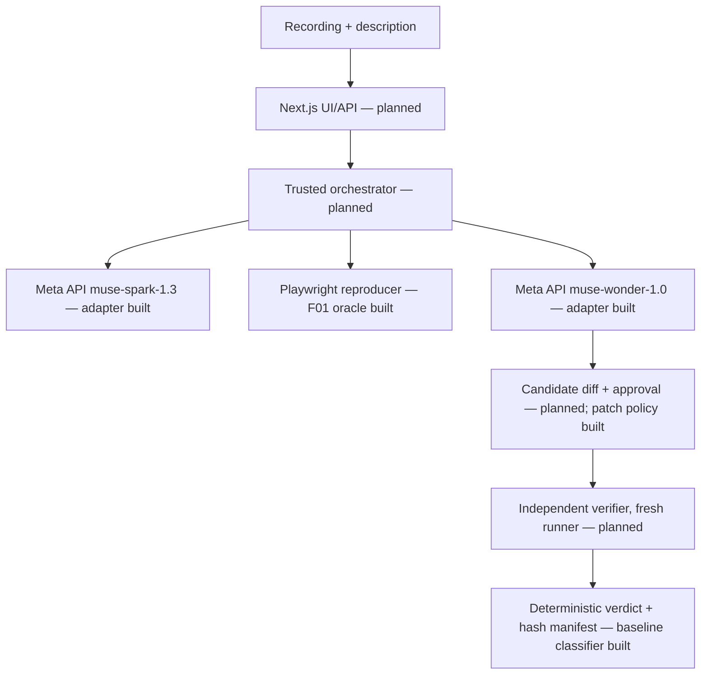

# Architecture

> The system as built, plus the planned topology. Durable rationale lives in `docs/PROJECT-MEMORY.md`.

## Architecture goals

- Patch generation and verification are separate trust domains.
- Verdicts are computed by deterministic code from trusted oracle results; model text is never evidence.
- Credentials stay in the trusted host process; the browser runner and fixture never receive them.
- Every claimed result is traceable to a Git SHA, an exact command, and hashed artifacts.

## System context

A developer supplies a short recording of a UI defect in one of the curated synthetic fixtures. ProofPilot asks Muse Spark to describe the symptom, reproduces it with Playwright, asks Muse Wonder for a scoped patch, applies it only after explicit local approval, and re-runs the hidden oracle in a fresh runner.

## Technology stack

| Layer | Technology | Notes |
|---|---|---|
| Language/runtime | TypeScript on Node.js 24 (native type stripping) | No build step; `tsc --noEmit` for typecheck |
| Package manager | pnpm 12 (single package) | `packages/*` are source modules imported by relative path, not separately published workspace packages |
| Browser automation | `@playwright/test` 1.64.1, Chromium headless | Pinned viewports 390×844 and 1280×800, locale en-US, TZ UTC |
| Model providers | Meta Model API (primary), Baseten (secondary) | OpenAI-compatible REST over native `fetch` |
| UI/API | Next.js (planned, C2+) | Requires the design-first gate |
| Storage | Local `.proofpilot/runs/<runId>/` (gitignored) | SQLite job store planned |
| Sandbox | Docker linux/arm64 (planned) | **NOT VERIFIED — agent environment lacks Docker access** (owner reports Docker Desktop installed on the host; not independently confirmed). Mandatory gate before executing AI-generated code or candidate patches. |
| CI/CD | GitHub Actions: Project baseline + Stack validation | |

## Component boundaries (built in C1)

### `fixtures/sample-store/` — defective fixture
Static HTML/CSS/JS served by `server.mjs` from a fixed route map on `127.0.0.1:4173`. Only `src/` is patchable.

### `verifier/` — trusted oracle (trust root)
Playwright config and `f01/f01.oracle.spec.ts`. Performs a real coordinate tap, records the hit-test target and cart counts as an observation attachment, and asserts `cart-count == "1"`. Starts a fresh fixture server per run (`reuseExistingServer: false`).

### `packages/core/` — deterministic logic
- `status.ts`: run status lexicon.
- `f01-baseline.ts`: classifies a Playwright JSON report as `REPRODUCED` / `NOT_REPRODUCED` / `INCONCLUSIVE`. `REPRODUCED` requires a `failed` mobile result with the exact `toHaveText` "1"/"0" mismatch, an observation showing the tap intercepted at 390×844, and a passing desktop control. Timeouts, selector or startup failures, or a broken desktop all abstain.
- `patch-policy.ts` + `config/patch-policy.json`: deny-by-default write policy for the patch agent (trust roots, traversal, secret names, extension allowlist).
- `env.ts`: `scrubEnv` strips credential-like variables before spawning the oracle.
- `metrics.ts`: impact-metrics schema with `provenance: "observed"` only.

### `packages/inference/` — provider adapter
- `config.ts`: provider contract (`meta`, `baseten`), env-based config, model-ID and base-URL validation (HTTPS + per-provider host allowlist), bounded timeout (1–120 s) and retries (0–2), and the billable-call opt-in.
- `client.ts`: `listModels`, `checkModelAvailability` (exact match; related IDs reported, never substituted), `generateText` (Meta `/responses`, Baseten `/chat/completions`). Uses `redirect: "error"`, `AbortSignal.timeout`, typed `InferenceError`, and redacted, truncated error detail.

### `scripts/`
- `f01-baseline.ts`: runs the oracle with a scrubbed env into a fresh run directory, classifies it, hashes every artifact, and writes `baseline-summary.json`, `metrics.json`, and `.proofpilot/metrics.jsonl`.
- `inference-status.ts`: config status, plus `--discover` (non-billable `GET /models`).
- `lint.mjs`: policy lint. `validate_project_profile.py`: template baseline validator.

## Impact instrumentation

Recorded per baseline run, observed values only (`packages/core/src/metrics.ts`):

| Metric | Definition |
|---|---|
| `bugReproductionMs` | Playwright duration of the mobile oracle test (navigate → tap → failing assertion) |
| `verificationExecutionMs` | Wall clock of the oracle process (fixture start, both tests, teardown) |
| `results.baselineFailure` | Classifier verdict |
| `results.regression` | Desktop control PASS/FAIL/NOT_RUN |
| `totalWorkflowMs` | Wall clock of the whole workflow named by `workflowScope`. In C1 this is `baseline-reproduction-only`, because there is no patch/verify stage yet. |

There are no fields for estimated or comparative savings. Any future comparison must come from separately measured runs.

## External integrations

| Integration | Purpose | Authentication | Failure behavior |
|---|---|---|---|
| Meta Model API `https://api.meta.ai/v1` | `muse-spark-1.3` visual analysis, `muse-wonder-1.0` patch proposal | `MODEL_API_KEY` (server-side env) | Typed error → run becomes `ANALYSIS_FAILED`/`INCONCLUSIVE`; no silent fallback |
| Baseten `https://inference.baseten.co/v1` | Optional `meta-models/muse-spark-open-1026` | `BASETEN_API_KEY` | Same; used only when explicitly selected |

## Trust boundaries

- Patch agent ↔ verifier: the patch agent may write only `fixtures/<id>/src/**` (`config/patch-policy.json`). `verifier/`, `packages/`, `tests/`, `scripts/`, `config/`, CI and lockfiles are trust roots.
- Host ↔ browser runner: the runner gets a credential-scrubbed environment and loopback-only fixture URLs.
- Host ↔ model provider: the key goes only to the allowlisted HTTPS host, with redirects refused. Model output is untrusted data.
- Planned: container isolation (no network, non-root, resource caps). Not yet implemented; container validation NOT VERIFIED — agent environment lacks Docker access.

See `docs/SECURITY.md`.

## Architectural change policy

A material architecture change should include updated documentation, risk-appropriate tests, migration/rollback considerations, and a `docs/PROJECT-MEMORY.md` entry when future agents need the rationale.

Deviation from the blueprint layout: provider adapters live in `packages/inference/` (Meta + Baseten) rather than `packages/meta/`, because both providers share one OpenAI-compatible client.
